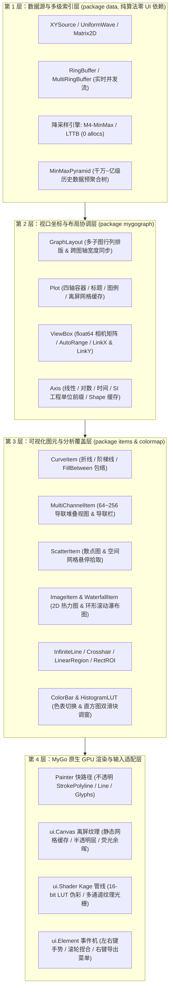

# mygograph 技术评估与总体架构设计方案

- **模块路径**：`github.com/gaoxi/mygograph`
- **目标平台**：[MyGo](https://github.com/egoist/mygo)（`v0.9+`，Native UI GPU 渲染引擎）
- **对标标杆**：Python `PyQtGraph`（科学计算、工程测量、多通道实时信号采集与时频分析可视化）
- **核心约束**：`CGO_ENABLED=0` 纯 Go 实现、跨平台原生 GPU 加速（Direct3D 11 / Metal / OpenGL / WebGL 2）、渲染热路径零内存分配（`0 allocs/op`）

---

## 目录

1. [项目定位与可行性结论](#1-项目定位与可行性结论)
2. [平台底座评估与技术路线选型](#2-平台底座评估与技术路线选型)
3. [mygo/ui 底层渲染机制深度剖析与四大性能陷阱](#3-mygoui-底层渲染机制深度剖析与四大性能陷阱)
4. [总体分层架构与核心组件映射](#4-总体分层架构与核心组件映射)
5. [四大核心业务场景与高性能管线设计](#5-四大核心业务场景与高性能管线设计)
6. [核心接口与数据结构规范](#6-核心接口与数据结构规范)
7. [工程交互状态机设计（复刻 PyQtGraph 手势）](#7-工程交互状态机设计复刻-pyqtgraph-手势)
8. [仓库目录规划与使用示例](#8-仓库目录规划与使用示例)
9. [性能验收指标、测试策略与实施路线图](#9-性能验收指标测试策略与实施路线图)

---

## 1. 项目定位与可行性结论

### 1.1 背景与生态现状

在科研仪器、生物医学信号（如 64~256 导联脑电 EEG/肌电 EMG）、数字示波器、逻辑分析仪及无线电频谱监测等桌面软件场景中，Python 生态长期依赖 `PyQtGraph` 实现高帧率实时绘图与探索式交互分析。随着 Go 语言凭借高并发采集能力与单文件部署优势在上位机及边缘测控领域普及，`github.com/egoist/mygo` 提供了纯 Go（`CGO_ENABLED=0`）跨平台原生 GPU 桌面开发能力，但其图表生态仍存在显著空白：

- **官方 `mygo/ui/chart` 定位局限**：官方架构文档明确指出 `ui/chart` 仅面向轻量静态或简单流式业务图表，**不包含缩放与平移（Zoom/Pan）、坐标轴联动、图例防重叠避让**，亦无热力图/瀑布图、多导联堆叠视图、测量游标与 ROI 截取能力。
- **社区生态现状**：当前 Awesome MyGo 收录的 24 个社区 UI 组件库主要聚焦于通用表单、主题系统（shadcn/Material 风格）或单一金融 K 线图，尚无面向工程测试测量与科学可视化的高性能绘图引擎。

### 1.2 核心可行性结论

通过对 `egoist/mygo` 运行时与 `package ui` 源码（`ui/paint.go`、`ui/polyline.go`、`ui/bitmap.go`、`ui/canvas.go`、`ui/shader`、`internal/scene`）的逐层验证，构建对标 `PyQtGraph` 的 **`mygograph` 完全可行，且在并发吞吐和部署体验上具备比 Python + Qt 更优的上限**：

1. **原生 GPU 实例渲染底座**：`mygo/ui` 底层通过 Metal（macOS）、Direct3D 11（Windows）、OpenGL（Linux）和 WebGL 2（WASM）硬件后端执行 2D SDF 图元实例渲染，并内置多核 CPU 光栅化兜底。
2. **三大关键硬件加速原语完备**：
   - **不透明折线硬件快路径**（`Painter.StrokePolyline` / `Painter.Line`）：直接生成 GPU 旋转矩形/轴对齐填充实例（`OpFill`），无需 CPU 路径光栅化。
   - **零拷贝动态纹理**（`Bitmap.Update` + `Bitmap.Pixelated` + `Painter.ImageRegion`）：支持 `*image.RGBA` 底层像素切片零拷贝交换与脏矩形局部上传。
   - **纯 Go 跨平台片段着色器**（`ui/shader`）：基于 Kage 语法在构建/运行时编译为各平台原生 GPU 着色器，可在 GPU 端直接完成伪彩色 LUT 映射、实时色阶对比度拉伸及超高密度多通道波形光栅化。
3. **首期重点全场景覆盖**：架构设计围绕以下四大一等公民场景展开，不做功能妥协：
   - **多通道实时波形流**（示波器、采集卡、64~256 导联脑电实时滚动与刷新扫描模式）
   - **百万至亿级历史点云/曲线丝滑缩放与游标精测**（`Crosshair`、`InfiniteLine`、峰值保持降采样）
   - **时频谱热力图与零搬移滚动瀑布图**（`ImageItem`、`WaterfallItem`、`ColorBar`、`HistogramLUT`）
   - **多子图坐标联动与区间截取分析**（`LinkX`/`LinkY`、跨图轴对齐、`LinearRegion`、`RectROI`）

---

## 2. 平台底座评估与技术路线选型

在 MyGo 平台上实现高性能科学绘图存在三条潜在技术路线，综合对比如下：

| 评估维度 | 路线 A：纯 `mygo/ui` 原生 GPU + `ui/shader`（选定方案） | 路线 B：MyGo WebView + WebGL2 / uPlot | 路线 C：外部图形库绑定（wgpu / OpenGL FFI） |
| :--- | :--- | :--- | :--- |
| **实时数据吞吐与延迟** | **极优**。Go 采集内存经降采样或零拷贝纹理直达同进程 GPU 渲染队列，零序列化损耗 | **受限**。高频多通道数据经 `mygo.Channel` 跨语言/跨进程传输存在编码拷贝开销与延迟抖动 | **极优**。可直接操作底层顶点缓冲，但与主 UI 窗口帧同步复杂 |
| **`CGO_ENABLED=0` 纯净度** | **100% 纯 Go**，仅依赖 `github.com/egoist/mygo`，交叉编译零障碍 | **纯 Go 编译**，但需同时维护 TypeScript 前端工程与打包静态资源 | **破坏约束**。大多依赖 CGo 或外部动态链接库分发 |
| **Native UI 组件融合度** | **原生融合**。图表本身即 `*ui.Element`，无缝参与 Flex/Grid 布局，直接调用原生菜单、弹窗、暗黑主题与快捷键 | **割裂**。嵌入式 `ui.WebView` 拥有独立系统合成表面，存在层级遮挡、焦点切换与输入穿透问题 | **极难融合**。子窗口句柄嵌入难以处理高分屏 DPI 缩放与裁剪 |
| **内存占用与启动速度** | **极低**（常驻数 MB 级，毫秒级冷启动） | **偏高**（WebView2 / WKWebView 独立渲染进程常驻 80~200 MB+） | **低** |
| **可测试性与离屏导出** | 原生支持 `ui.Tester` 无窗口确定性交互测试，以及 `ui.Render` 高清离屏渲染导出 | 依赖无头浏览器端到端测试，CI 维护重 | 需自行构建平台无关离屏上下文 |
| **WASM 浏览器兼容** | 天然支持 `GOOS=js GOARCH=wasm`（自动映射至 WebGL 2） | 需拆分独立 Web 构建物 | 难以移植 |

**选型结论**：采用 **路线 A（纯 `mygo/ui` 原生 GPU 图元 + `ui/shader` 自定义着色器混合管线）**。常规曲线与交互层使用 `Painter` 硬件矢量快路径，二维矩阵热力图与百通道级高密度波形使用 `Bitmap` + `Shader` 光栅管线，兼顾矢量清晰度与极致像素吞吐。

---

## 3. `mygo/ui` 底层渲染机制深度剖析与四大性能陷阱

深入研读 `mygo` 渲染引擎源码后，识别出四个决定实时绘图成败的底层机制陷阱，并制定对应的工程级破解方案：

### 陷阱 1：半透明 `StrokePolyline` 退化为 CPU 路径光栅化的性能悬崖

- **源码机制剖析**（见 `mygo/ui/polyline.go` 与 `docs/architecture.md`）：
  - 在 GPU 后端下，当 `Painter.StrokePolyline(points, width, color)` 接收**完全不透明颜色**（`color.A == 255` 且 `Painter` 当前整体不透明度为 `1.0`）时，引擎走**无掩码硬件快路径**：每条线段直接发射一个带圆头的旋转矩形 SDF 实例（`scene.OpFill`），CPU 零光栅化开销。
  - **一旦 `color.A < 255` 且顶点数 `> 2`**，为避免相邻线段接头处半透明叠加变暗，引擎会强制退化至 `drawPath` 慢路径：在 CPU 上运行 `internal/vec` 扫描线光栅化生成覆盖率掩码，再打包上传至 `MaskAtlas`；当曲线跨度超过 `511px` 时还会触发分块切片，甚至引发 `System.MakeRoom` 纹理图集重排与整帧重绘。在 60 FPS 动态波形场景下，该退化会直接耗尽 CPU 单核预算。
- **工程规避准则**：
  1. **动态曲线主干强制不透明（`A = 255`）**：利用高对比度调色板区分多条重叠曲线，确保 100% 命中 GPU `OpFill` 快路径。
  2. **轴对齐线段优先使用 `Painter.Line`**：水平/垂直网格线、坐标刻度、十字游标（`Crosshair`）及单像素列极值竖线（MinMax 柱）统一调用 `Painter.Line`（单段直线即使半透明也直接发射 `OpFill`，不经过 `MaskAtlas`）。
  3. **离屏纹理合成实现高性能半透明层**：对于置信区间包络带（`FillBetween`）、半透明区域选框（`LinearRegion`）或示波器数字荧光余晖（Persistence Mode），先以不透明画笔渲染至离屏 `ui.Canvas`（GPU Render-to-Texture），再通过单次 `Painter.DrawCanvas(cv, dst, ui.DrawOpts{Opacity: alpha})` 在 GPU 端完成整层 Alpha 混合。

### 陷阱 2：64~256 导联高密度波形下的 `scene.Op` 实例数量瓶颈

- **源码机制剖析**：
  - 单条横跨 `1920px` 的高频曲线经像素列 MinMax 降采样后约生成 `2000~3840` 条线段。
  - 在 **1~32 通道**规模下（每帧约 `3万~10万` 个 `OpFill`），`StrokePolyline` / `Line` 在主流独显与核显上均可稳定跑满 `60~120 FPS`。
  - 当扩展至 **64~256 导联脑电（EEG）或高通道数采集系统**时，每帧高达 `25万~90万` 个场景操作实例会导致 CPU 侧指令切片增长、边界裁剪与批次提交开销显著上升。
- **工程破解方案：双模自适应曲线渲染器（Dual-Tier Curve Renderer）**：
  - **Tier 1 矢量精确管线（通道数 `<= 32` 或放大查看局部细节时）**：CPU 完成降采样后直接调用不透明 `StrokePolyline` / `Line`，支持任意线宽、阶梯线、数据点标记与悬停精确拾取。
  - **Tier 2 GPU 着色器光栅管线（`MultiChannelItem` 在 `> 32` 通道时自动或手动启用）**：
    - CPU 在并行/单线程扫描环形缓冲区时，仅计算每个通道在每个水平像素列的归一化 `(yMin, yMax)`，写入一张尺寸为 $W \times N_{\text{ch}}$ 的紧凑 `*image.RGBA` 图像（例如 `2000px × 256ch` 仅 `2 MB`，每通道每列将 `yMin`、`yMax` 各以 16-bit 精度拆分存入 `R,G` 与 `B,A` 字节）。
    - 调用 `Bitmap.Update` 零拷贝更新纹理后，由 `multistack.kage` 片段着色器在**单次 `Painter.DrawShader` 调用（仅 1 个 GPU 矩形图元）**内并行计算全部 256 个通道的垂直偏移、增益缩放、边缘距离抗锯齿（SDF 近似平滑）以及坏道变灰/选中高亮。

### 陷阱 3：`float64` 物理量/大时间戳与 `float32` 屏幕坐标的精度失真

- **机制剖析**：
  - `mygo/ui` 的 `Painter` 坐标、变换矩阵与 `Shader` Uniform 全部采用 `float32`（IEEE 754 单精度尾数仅 24 bit，约 7 位有效十进制数字）。
  - 科学采集中常见两类极端数值：一是 Unix 秒级或纳秒级绝对时间戳（如 `t = 1776001234.000250 s`，需 16 位十进制精度）；二是带有较大直流偏置的微弱传感器信号（如在 `2.500000 V` 偏置上观察 `10 uV` 纹波）。若直接将原始坐标转为 `float32` 再交由 `Painter.Transform` 缩放，视口放大后波形会出现严重像素阶跃甚至坍缩成直线。
- **工程破解方案：相机相对坐标原点平移（Camera-Relative Origin Shifting）**：
  - 数据源接口（`DataSource`）、比例尺（`Scale`）与视口状态（`ViewBox`）内部**全链路强制采用 `float64`** 存储与解算。
  - 设当前视口数据范围为 $[x_{\text{min}}, x_{\text{max}}]$，画布像素宽度为 $W$，像素比例因子为 $s_x = W / (x_{\text{max}} - x_{\text{min}})$。任意样本点 $x_i$ 向屏幕空间投影时，严格在 `float64` 寄存器内先做减法消去大基数，最后一步再窄化为 `float32`：
    $$x_{\text{px}} = \text{float32}\bigl((x_i - x_{\text{min}}) \cdot s_x\bigr)$$
  - 对于对数坐标轴（`LogScale`），同样在 `float64` 域执行 $\log_{10}(x)$ 变换与正值保护裁剪后再投影至屏幕像素。

### 陷阱 4：高频采集推送引发的主线程唤醒洪泛与 GC 抖动

- **机制剖析**：
  - MyGo 在界面静止时处于 0% CPU 事件休眠态。若后台硬件采集协程（如 USB/PCIe/网卡以 `1 kHz~100 kHz` 接收数据包）每收到一包就调用 `window.Update` 或 `Invalidate`，会产生大量冗余唤醒并阻塞主线程输入响应。
  - 若每帧在 `Draw` 回调中动态 `make([][2]float32, n)` 或格式化刻度字符串 `fmt.Sprintf`，高频产生的短生命周期对象会频繁触发 Go GC 标记扫描，引起微卡顿（帧时间毛刺 `> 16.6 ms`）。
- **工程破解方案：生产-消费 VSync 解耦 + 热路径零分配池**：
  1. **拉取式帧步调（Pull-on-VSync）**：采集协程仅向并发安全的 `RingBuffer` 追加采样块，并递增原子版本号 `seq atomic.Uint64`（当窗口处于空闲挂起态重新收到首个数据块时，仅通过原子布尔锁触发一次轻量唤醒）。处于活跃流模式的 `Plot` 通过 `p.AnimationFrame()`（或可配置的 `p.AnimationFrameRate(60)`）按屏幕垂直同步信号主动拉取最新快照。当数据流停止且 `seq` 未变时，停止请求下一动画帧，CPU 占用自动降回 `0%`。
  2. **全管线预分配复用**：每个图层实例各自持有一块按视口最大像素宽度预分配的工作区切片（如 `ptsBuf [][2]float32`、`bucketBuf []MinMaxBucket`）；坐标轴刻度文本仅在视口跨越刻度步长阈值时使用 `strconv.AppendFloat` 原地构建并通过 `ui.Shape` 缓存字形序列（`GlyphRun`），保证稳态帧渲染实现 **`0 B/op, 0 allocs/op`**。

---

## 4. 总体分层架构与核心组件映射

### 4.1 架构分层图



### 4.2 PyQtGraph 核心能力与 `mygograph` 完整映射表

| PyQtGraph 模块/类 | `mygograph` 对应组件 | 设计要点与增强点 |
| :--- | :--- | :--- |
| `GraphicsLayoutWidget` | `GraphLayout` | 支持多行多列子图嵌套、拖拽分隔条调节子图高度占比（Splitter），核心提供 `AlignAxes(Left, Right)` 确保上下多张子图绘图区左/右边界严格像素级对齐 |
| `PlotWidget` / `PlotItem` | `Plot` | 封装中心 `ViewBox`、四向 `Axis`、网格层、浮动 `Legend`、左下角 `[A]` 自动复位角标与右键上下文菜单 |
| `ViewBox` | `ViewBox` | `float64` 视口变换、边界约束（`Limits`）、Y 轴翻转（`InvertY`）、长宽比锁定（`AspectLocked`）、双向无环联动（`LinkX` / `LinkY`）、框选缩放栈（`ZoomHistory` 支持回退） |
| `AxisItem` | `Axis` | 完整复刻 PyQtGraph 标志性的 **SI 国际单位前缀自动换算**（如 `250e-6` 自动显示为 `250 μV` 且轴标题联动更新为 `Amplitude (μV)`）、高精度时间轴、对数轴与标签防碰撞剔除 |
| `PlotDataItem` / `PlotCurveItem` | `CurveItem` | 支持连续折线、`StepMode` 阶梯图、NaN 断线处理、自动像素桶 `MinMax` 与 `LTTB` 降采样 |
| *(业务层手工偏移实现)* | `MultiChannelItem` | **原生一等公民组件**：专为 16~256 通道脑电/逻辑分析仪/振动阵列打造，内置统一/独立通道增益（$\mu\text{V}/\text{div}$）、基线去直流（DC Removal / Detrend 视图级开关）、单通道静音/置顶放大与双模 GPU 渲染 |
| `ScatterPlotItem` | `ScatterItem` | 支持按数据点动态映射颜色/大小，内置二维均匀网格空间索引（Spatial Hash Grid），百万点内实现 `< 0.1 ms` 鼠标最近点拾取与数值气泡提示 |
| `ImageItem` | `ImageItem` | 二维标量场热力图，支持自定义数据域变换矩形（物理坐标原点与像素分辨率 $dx, dy$），GPU 16-bit 精度实时伪彩渲染，放大至像素级自动开启 `Pixelated` 锐利网格显示 |
| *(业务层手写滚动切片)* | `WaterfallItem` | **原生一等公民组件**：面向 STFT 时频谱、声呐与无线电频谱瀑布图，基于环形纹理行覆写 + 双区间拼接绘制，新增一帧频谱零全图内存搬移 |
| `ColorBarItem` / `HistogramLUTItem` | `ColorBar` / `HistogramLUT` | 内置科研标准感知均匀色表（`Viridis`、`Plasma`、`Inferno`、`Magma`、`Cividis`、`Turbo`、`Coolwarm`、`Grayscale`）；`HistogramLUT` 右侧实时绘制像素强度分布直方图，支持拖拽上下阈值线动态压扩色阶 `[vMin, vMax]` |
| `InfiniteLine` | `InfiniteLine` | 支持水平、垂直及任意角度无限长参考线/触发电平线，带可拖拽手柄与实时边缘数值铭牌 |
| `LinearRegionItem` | `LinearRegion` | 水平或垂直双边界半透明选框，支持拖拽单边调整宽度或拖拽中心整体平移，驱动“时域选段 -> 频域重算”联动工作流 |
| `ROI` (`RectROI`, `LineSegmentROI`) | `RectROI` / `LineROI` | 二维矩形感兴趣区域（支持四角缩放与平移手柄）及任意剖面线 ROI（用于从热力图中提取一维强度剖面曲线） |
| `SignalProxy` | 内置帧同步事件节流 | 高频鼠标移动读数、选框拖拽变更默认按帧合并分发，防止下游 FFT 或统计计算阻塞 UI 帧率 |

---

## 5. 四大核心业务场景与高性能管线设计

### 5.1 场景一：多通道实时波形流（示波器 & 64~256 导联脑电采集）

支持工业与医学仪器最核心的两种实时走纸模式：

1. **滚动走纸模式（Roll / Strip Chart Mode）**：最新数据始终位于视口右边缘，时间轴窗口 $[t_{\text{now}} - T_{\text{win}}, t_{\text{now}}]$ 随采样推进平滑左移。
2. **擦除扫描模式（Sweep / Erase-Bar Mode，心电/脑电监护仪经典模式）**：时间轴刻度固定在 $[0, T_{\text{win}}]$，新数据从左向右循环覆写旧波形，并在扫描头 `cursorX` 处留出一段可配置宽度的空白擦除间隙（Erase Gap）与高亮扫描竖线，视觉上波形静止不晃眼，极适合长时间人工判读。

**高密度 256 导联 Kage 着色器渲染原理（`shaders/multistack.kage`）**：
- 纹理槽 `image0`（尺寸 $W \times N_{\text{ch}}$）：每个纹素存储第 $c$ 通道在第 $x$ 像素列的归一化垂直包络 `[yMin, yMax]`（各自量化为 16-bit 存入 `RG` 和 `BA` 通道）。
- 纹理槽 `image1`（尺寸 $N_{\text{ch}} \times 1$）：存储每通道独立配色与状态标志（正常、选中高亮、坏道屏蔽）。
- 片段着色器根据当前像素的屏幕纵坐标 `dstPos.y` 直接定位所属导联邻域（含相邻上下各 1~2 个导联以支持大振幅跨导联重叠波形，这也是真实脑电图的关键特征！），计算像素中心到线段 $[y_{\text{min}}, y_{\text{max}}]$ 的有符号距离并应用 `smoothstep` 边缘抗锯齿，单次 DrawCall 即可完成全部 256 导联的高清绘制。

```go
//kage:unit pixels
package main

var ChannelCount float
var ChannelHeight float
var GainScale float
var OverlapRadius float // 允许跨导联越界绘制的邻域半径（如 3.0 表示检测上下各3个导联）
var StrokeHalfWidth float

func unpack16(hi, lo float) float {
    // 还原归一化有符号幅值 [-1.0, +1.0]
    u := (hi*255.0*256.0 + lo*255.0) / 65535.0
    return u*2.0 - 1.0
}

func Fragment(dstPos vec4, srcPos vec2, color vec4) vec4 {
    x := floor(srcPos.x) + 0.5
    centerCh := floor(srcPos.y / ChannelHeight)
    outColor := vec4(0.0)

    // 仅遍历可能覆盖当前像素 Y 坐标的局部相邻导联（常数次循环，复杂度 O(1)）
    for offset := -3.0; offset <= 3.0; offset += 1.0 {
        if abs(offset) > OverlapRadius {
            continue
        }
        ch := centerCh + offset
        if ch < 0.0 || ch >= ChannelCount {
            continue
        }
        raw := image0At(vec2(x, ch+0.5))
        vMin := unpack16(raw.r, raw.g) * GainScale
        vMax := unpack16(raw.b, raw.a) * GainScale

        baseY := (ch + 0.5) * ChannelHeight
        // 屏幕 Y 轴向下为正，数值越大屏幕 Y 越小
        yTop := baseY - vMax*(ChannelHeight*0.5)
        yBot := baseY - vMin*(ChannelHeight*0.5)

        // 计算当前像素到垂直区间 [yTop, yBot] 的距离并做 1px 抗锯齿过渡
        dist := max(yTop-dstPos.y, max(0.0, dstPos.y-yBot))
        alpha := 1.0 - smoothstep(StrokeHalfWidth-0.5, StrokeHalfWidth+0.5, dist)
        if alpha > 0.0 {
            chCol := image1At(vec2(ch+0.5, 0.5))
            // Premultiplied alpha 混合
            src := vec4(chCol.rgb*alpha, alpha)
            outColor = src + outColor*(1.0-src.a)
        }
    }
    return outColor
}
```

### 5.2 场景二：百万至亿级历史曲线丝滑缩放与游标测量

1. **M4 保峰像素桶降采样（实时/中等规模 `< 500 万点`）**：
   - 利用单调 X 轴二分定位视口起止索引 $[i_0, i_1]$；
   - 将水平 $W$ 个像素列作为分桶，单次遍历提取每个桶内的四个特征点：桶内首点 `first`、全局最小值点 `min`、全局最大值点 `max`、桶内末点 `last`（按原始时间先后顺序排列去重）。
   - **数学保证**：与任意全量折线光栅化结果相比，M4 降采样在像素网格上的包络轮廓**100% 无损一致**，绝不会像等步长抽样（Stride）或单纯均值抽样那样漏掉纳秒级尖峰毛刺（Glitch/Spike）。
2. **多级金字塔预聚合索引 `MinMaxPyramid`（大规模历史记录 `500 万 ~ 10 亿点`）**：
   - 以分支因子 $B = 64$ 自底向上构建多级 `(min, max)` 汇总层：
     - L0：原始样本 $N$ 点
     - L1：$N / 64$ 个汇总块
     - L2：$N / 4096$ 个汇总块
     - L3：$N / 262144$ 个汇总块
   - 渲染任意时间跨度 $\Delta t$ 时，自动选取满足“每像素包含 $1 \sim 64$ 个汇总块”的最高层级 $L_k$ 进行扫描。即使对 **1 亿个采样点（约 800 MB）** 做全览到单周期的极速滚轮缩放，每帧 CPU 扫描点数始终不超过 $64 \times W \approx 12\text{ 万次}$ 基本比较，单帧耗时稳定在 **`0.2 ms` 以内**。
3. **精密工程游标测量体系**：
   - **十字追踪游标（`Crosshair`）**：随鼠标悬停实时吸附最近曲线采样点（Snap-to-Data）或自由插值，四角浮动读数面板显示精确物理坐标。
   - **双游标差值测量（Dual `InfiniteLine` Measurement）**：支持放置时间游标 `T1, T2` 与幅值游标 `V1, V2`，内置测量信息栏自动实时解算并按 SI 单位展示 $\Delta t = T_2 - T_1$、等效频率 $f = 1 / |\Delta t|$、幅值差 $\Delta V = V_2 - V_1$ 及区间内有效值 $\text{RMS}$、峰峰值 $V_{\text{pp}}$。

### 5.3 场景三：时频谱热力图与滚动瀑布图（`ImageItem` / `WaterfallItem` + `HistogramLUT`）

1. **零重算 GPU 伪彩与动态调窗管线（`shaders/lut.kage`）**：
   - 科研图像（如功率谱密度 dBm/Hz、脑电时频能量、红外热像）的原始动态范围远超 8-bit。`ImageItem` 保存原始 `[]float32` 矩阵用于鼠标悬停精确读数，同时维护量化的 16-bit 强度纹理（存入 `RG` 双字节，支持 65536 级灰度分辨力）。
   - 用户在右侧 `HistogramLUT` 组件上拖拽上下色阶线改变显示窗宽窗位 `[vMin, vMax]`，或切换色表（如从 `Viridis` 切至 `Turbo`）时，**完全不触碰原始矩阵与纹理上传**，仅修改着色器 Uniform `VMin` 与 `InvSpan`，60~120 FPS 丝滑响应百万像素热力图调窗。
2. **零拷贝环形滚动瀑布图（`WaterfallItem`）**：
   - 针对实时 STFT 频谱瀑布图（水平方向为时间推进或垂直方向自上而下瀑布滚动），内部开辟固定分辨率 $N_{\text{bins}} \times H_{\text{history}}$ 的 `*image.RGBA` 环形缓冲与写指针 `writeIdx`。
   - 每到达一帧新 FFT 结果（如 1024 个频点），仅量化写入第 `writeIdx` 行，调用 `Bitmap.Update` 提交更新。
   - 绘制时根据 `writeIdx` 将纹理拆分为上下（或左右）两个连续矩形区域，通过两次调用 `Painter.ImageRegion`（或着色器 UV 环形取模 `fract`）无缝拼合到视口数据坐标系中，内存带宽消耗降低两个数量级。

### 5.4 场景四：多子图联动与区间截取分析（`LinkX/Y` + `LinearRegion` / `ROI`）

1. **有向无环视口同步图（`LinkGroup`）**：
   - 调用 `subPlotB.ViewBox().LinkX(subPlotA.ViewBox())` 后，两个（或任意多个）子图共享同一套水平视口范围事务与重入保护版本号（防止双向回调死循环）。在任意一张子图上平移、滚轮缩放或双击复位，其余关联子图在同一帧内零延迟同步变换（不会出现相差一帧的视觉撕裂）。
2. **跨行坐标轴自动对齐（`GraphLayout.AlignAxes`）**：
   - 经典场景：上方为 32 通道时域波形图（左侧 Y 轴刻度为 `Ch01..Ch32`，标签较宽），下方为对应的时频谱瀑布图（左侧 Y 轴刻度为 `0..500 Hz`，标签较窄）。若各自独立排版，两张图的绘图区左边缘会错位，导致同一时间点的波形与频谱无法上下对齐。
   - `GraphLayout` 在每帧测量（Measure）阶段汇总同列所有 `Plot` 左侧/右侧坐标轴的最大所需像素宽度 $W_{\text{axisMax}}$，统一赋予同列各子图的边距，实现严格的像素级垂直对齐。
3. **总览-细节联动（Overview-Detail）与 ROI 实时切片**：
   - 支持底部放置一张全局缩略总览图并在其上挂载 `LinearRegion`，上方放置细节放大图：拖拽底部 `LinearRegion` 实时驱动上方 `ViewBox.SetXRange(rMin, rMax)`，反之在上方细节图缩放平移也实时回写底部选框位置（完全对应 PyQtGraph 最经典的 `region.sigRegionChanged` 范式）。
   - `RectROI` 与 `LineROI` 提供直接作用于 `CurveSource` 或 `ImageItem` 的零拷贝/预分配切片提取方法 `ExtractSubMatrix(dst)` / `SampleProfile(dst, numSamples)`，供下游算法即时计算局部功率谱或灰度剖面。

---

## 6. 核心接口与数据结构规范

### 6.1 数据源层（`package data`）

将数据存储与图形渲染彻底解耦，同时覆盖静态切片、等间隔采样流、二维矩阵与多通道环形缓冲：

```go
package data

// Range 表示 float64 闭区间 [Min, Max]
type Range struct {
    Min, Max float64
}

// XYSource 通用非均匀/均匀一维曲线数据源接口
type XYSource interface {
    Len() int
    XY(i int) (x, y float64)
    Bounds() (xRange, yRange Range, ok bool)
    // MonotonicX 返回 true 时允许启用 O(log N) 二分裁剪与像素桶极速降采样
    MonotonicX() bool
    // Version 返回单调递增的数据版本号，供渲染层判断缓存是否失效
    Version() uint64
}

// UniformSource 面向固定采样率硬件信号（x_i = T0 + i * Dt），节省一半内存并支持 O(1) 下标直算
type UniformSource interface {
    Len() int
    T0() float64
    Dt() float64 // 1.0 / SampleRate
    Y(i int) float64
    YSlice() []float64 // 可选暴露连续内存供 SIMD/批量扫描快路径使用
    Version() uint64
}

// MultiChannelSource 面向 16~256 通道同步采样流（如 EEG / DAQ 采集卡）
type MultiChannelSource interface {
    Channels() int
    ChannelName(ch int) string
    SampleRate() float64
    // ReadWindow 读取指定时间窗口 [tStart, tEnd] 内某通道的连续片段或像素桶极值
    DecimateWindow(ch int, tStart, tEnd float64, buckets int, dst []MinMax) (valid int)
    LatestTime() float64
    Version() uint64
}

// MinMax 表示单个像素列桶内的幅值包络
type MinMax struct {
    First, Min, Max, Last float32
    Valid                 bool
}
```

### 6.2 视口与相机变换模型（`ViewBox`）

```go
package mygograph

type MouseMode int

const (
    PanMode  MouseMode = iota // 左键拖拽平移（默认）
    RectMode                  // 左键拉框放大（松开后推入缩放历史栈）
)

type AxisMask uint8

const (
    AxisX    AxisMask = 1 << 0
    AxisY    AxisMask = 1 << 1
    AxisBoth          = AxisX | AxisY
)

type ViewLimits struct {
    XMin, XMax       float64 // 允许浏览的最大数据边界（NaN 表示不限制）
    YMin, YMax       float64
    MinXSpan         float64 // 防止过度放大导致浮点下溢的最小跨度限制
    MaxXSpan         float64
    MinYSpan         float64
    MaxYSpan         float64
}

type ViewBox struct {
    // 核心坐标变换（内部保存 float64 范围，输出相对于视口左上角的局部 float32 DIP 像素）
    // DataToScreenX(x float64) float32 -> float32((x - xMin) * pxPerUnitX)
    // ScreenToDataX(px float32) float64 -> xMin + float64(px) / pxPerUnitX
}

func (vb *ViewBox) SetRange(xMin, xMax, yMin, yMax float64, padding float64)
func (vb *ViewBox) SetXRange(xMin, xMax float64, padding float64)
func (vb *ViewBox) SetYRange(yMin, yMax float64, padding float64)
func (vb *ViewBox) EnableAutoRange(axes AxisMask, enable bool)
func (vb *ViewBox) AutoRange() // 立即根据所有可见 Item 数据边界复位视口
func (vb *ViewBox) LinkX(target *ViewBox)
func (vb *ViewBox) LinkY(target *ViewBox)
func (vb *ViewBox) SetLimits(lim ViewLimits)
func (vb *ViewBox) SetInvertY(invert bool)
func (vb *ViewBox) SetAspectLocked(locked bool, ratio float64)
func (vb *ViewBox) SetMouseMode(mode MouseMode)
```

### 6.3 图元扩展协议（`Item` 接口）

所有可视化图层与交互覆盖物实现统一的 `Item` 协议，方便用户自定义业务专属图元（如脑电事件标记 Event Marker、滤波器频响曲线、故障告警框）：

```go
package mygograph

import "github.com/egoist/mygo/ui"

// RenderContext 封装单帧绘制所需的相机投影、裁剪盒与帧同步控制接口
type RenderContext struct {
    Painter      *ui.Painter
    ViewBox      *ViewBox
    ViewportRect ui.Rect // 绘图区局部像素矩形 (0, 0, W, H)
    DarkTheme    bool
    RequestFrame func()  // 流式动态图元调用以请求下一 VSync 帧
}

type Item interface {
    // ZIndex 控制绘制与事件命中优先级（背景图像 < 网格 < 曲线 < 游标/ROI < 十字读数）
    ZIndex() int
    Visible() bool
    // DataBounds 返回图元在数据域的包围盒，供 AutoRange 聚合计算（参考线等无界图元返回 ok=false）
    DataBounds() (xRange, yRange data.Range, ok bool)
    // Draw 在已裁剪的 ViewBox 画布空间内执行零分配绘制
    Draw(rc *RenderContext)
}

// InteractiveItem 可选接口：需要响应鼠标悬停、拖拽手柄的交互图元（如 InfiniteLine, LinearRegion, ROI）实现
type InteractiveItem interface {
    Item
    // HitTest 返回鼠标距离手柄/本体的命中状态及对应鼠标指针样式（如左右双向箭头 ResizeEW）
    HitTest(vb *ViewBox, pos [2]float32) (hit bool, cursor ui.Cursor)
    HandleInput(vb *ViewBox, ev ui.InputEvent) (consumed bool)
}
```

---

## 7. 工程交互状态机设计（复刻 PyQtGraph 手势）

为让熟悉 `PyQtGraph`、数字示波器或 LabVIEW 的工程师零学习成本上手，`Plot` 与 `ViewBox` 的输入处理严格遵循以下优先级与手势映射：

### 7.1 输入事件路由优先级

每次收到 `ui.InputEvent` 时，按以下顺序自顶向下分发：
1. **交互式覆盖物命中（ZIndex 降序）**：优先检测鼠标是否命中 `ROI` 控制柄、`LinearRegion` 边界线或可拖拽的 `InfiniteLine`。若命中，悬停时自动切换鼠标样式（`CursorEWResize` / `CursorNSResize` / `CursorMove`），按下后锁定该图元捕获后续 `PointerMove` 直至 `PointerUp`。
2. **单坐标轴独立交互区**：当鼠标位于底部/顶部 X 轴区域滚动滚轮或右键拖拽时，**仅缩放/平移 X 轴**；位于左/右侧 Y 轴区域操作时，**仅缩放/平移 Y 轴**。
3. **中心 `ViewBox` 画布手势**：
   - **左键拖拽（`PanMode`）**：实时平移 X/Y 视口；若当前开启了 `AutoRange`，用户主动拖拽后自动暂停手动轴的 `AutoRange`（防止流式新数据强行把画面拉回），左下角浮现醒目的 `[A]` 按钮提示可一键恢复自动跟随。
   - **左键拖拽（`RectMode`）**：绘制带半透明填充与边框的放大选框；松开左键瞬间将原视口压入 `ZoomStack` 并放大至选框区域；按鼠标侧键返回、`Backspace` 或右键菜单可逐级回退上一次缩放视口。
   - **右键任意拖拽（PyQtGraph 灵魂手势）**：以右键按下瞬间的数据坐标 $(x_{\text{anchor}}, y_{\text{anchor}})$ 为不动锚点，鼠标水平向右移动按指数比例放大 X 轴、向左缩小 X 轴；垂直向上移动放大 Y 轴、向下缩小 Y 轴（单次拖拽即可同时调好时间展宽与幅值增益）。
   - **中键拖拽**：无论当前处于 `PanMode` 还是 `RectMode`，中键始终执行画布平移。
   - **鼠标滚轮 / 触控板双指缩放（`InputScroll` / `InputZoom`）**：以光标所在的数据点为不动点执行等比缩放；按住 `Ctrl` 滚轮仅缩放 X 轴，按住 `Shift` 滚轮仅缩放 Y 轴（`MultiChannelItem` 下按住 `Alt` 滚轮直接调节通道波形增益 `Gain`）。
   - **左键双击**：重置回全局 `AutoRange` 完整视图（流式模式下重新激活自动跟随最新窗口）。
   - **右键单击（未发生拖拽位移时）**：弹出原生 `ui.ContextMenu`，支持一键复位视口、切换 `Pan / RectZoom` 模式、开启/关闭网格与十字游标、切换线性/对数轴、导出高清 PNG 截图或导出当前视口 CSV 数据。

---

## 8. 仓库目录规划与使用示例

### 8.1 模块目录结构（`github.com/gaoxi/mygograph`）

```text
mygograph/
├── go.mod                        # module github.com/gaoxi/mygograph
├── DESIGN.md                     # 本架构设计规范文档
├── theme.go                      # 亮色/暗色科研高对比度配色方案与调色板
├── viewbox.go                    # float64 视口状态、相机投影、Limits、LinkX/LinkY 同步器
├── scale.go                      # LinearScale、LogScale、TimeScale 数学映射与刻度生成算法
├── axis.go                       # 四向坐标轴、SI 国际单位前缀格式化、ui.Shape 字形缓存与防碰撞
├── plot.go                       # Plot 核心组件（四轴布局、网格 Canvas 缓存、图例、手势状态机）
├── layout.go                     # GraphLayout 多图行列排版、可拖拽分隔条与跨图轴边距对齐
├── export.go                     # 基于 ui.Render 的高清离屏 PNG 导出与视口数据 CSV 导出
├── data/                         # 纯数据与信号降采样包（零 UI 依赖，100% 单元测试与 Benchmark 覆盖）
│   ├── source.go                 # XYSlice、UniformSlice、FuncSource 等标准数据源实现
│   ├── ring.go                   # 单通道 RingBuffer 与多通道同步 MultiRingBuffer
│   ├── decimate.go               # M4 (First-Min-Max-Last) 像素桶与 LTTB 零分配降采样器
│   └── pyramid.go                # 面向千万~亿级样本的 MinMaxPyramid 多级预聚合索引
├── colormap/                     # 科研伪彩色表与交互式色阶控件
│   ├── lut.go                    # ColorMap 结构及 Viridis/Turbo/Plasma/Inferno/Jet/Grayscale 表
│   └── colorbar.go               # ColorBar 静态/可拖拽色标条与 HistogramLUT 直方图调窗组件
├── items/                        # 图元与测量分析覆盖物包
│   ├── curve.go                  # CurveItem（实线、阶梯线、FillBetween 上下包络带）
│   ├── multichannel.go           # MultiChannelItem（16~256 导联堆叠模型、增益控制、双模渲染）
│   ├── scatter.go                # ScatterItem（散点符号图集渲染与空间哈希悬停拾取）
│   ├── image.go                  # ImageItem（2D 矩阵热力图）与 WaterfallItem（环形滚动瀑布图）
│   ├── cursor.go                 # InfiniteLine（测量/触发线）、Crosshair（十字追踪读数）
│   └── roi.go                    # LinearRegion（一维区间选框）、RectROI、LineROI
├── shaders/                      # Kage GPU 片段着色器源码与懒加载编译缓存
│   ├── shaders.go                # //go:embed 嵌入与全局 Shader 单例编译管理
│   ├── lut16.kage                # 16-bit 标量纹理 -> LUT 伪彩与实时窗宽窗位拉伸着色器
│   └── multistack.kage           # 64~256 通道列包络抗锯齿并行光栅化着色器
└── examples/                     # 四大核心场景标杆演示与压力测试程序
    ├── 01_million_points_cursor/ # 1000 万点历史波形金字塔瞬时缩放 + 双游标 Δt/ΔV/RMS 测量
    ├── 02_eeg_256ch_realtime/    # 256 导联 1kHz 实时脑电滚动/擦除扫描双模式压测
    ├── 03_spectrogram_waterfall/ # 实时波形 + STFT 滚动时频瀑布图 + HistogramLUT 调色阶
    └── 04_linked_region_roi/     # 多子图 X 轴严格对齐联动 + LinearRegion 选段实时频谱分析
```

### 8.2 综合联动业务代码示例预览

下面展示在一个典型的“多通道实时采集 + 选段时频联动分析”上位机界面中使用 `mygograph` 的完整代码形态：

```go
package main

import (
    "github.com/egoist/mygo"
    "github.com/egoist/mygo/ui"
    "github.com/gaoxi/mygograph"
    "github.com/gaoxi/mygograph/colormap"
    "github.com/gaoxi/mygograph/data"
    "github.com/gaoxi/mygograph/items"
)

type AnalyzerState struct {
    Ring      *data.MultiRingBuffer
    WavePlot  *mygograph.Plot
    SpecPlot  *mygograph.Plot
    Waterfall *items.WaterfallItem
    HistLUT   *colormap.HistogramLUT
    Layout    *mygograph.GraphLayout
}

func NewAnalyzerState() *AnalyzerState {
    // 1. 创建 128 通道、采样率 2000 Hz、容量 30 秒的并发安全环形缓冲
    ring := data.NewMultiRingBuffer(128, 2000.0, 128*2000*30)

    // 2. 构建上方多导联实时波形图
    wavePlot := mygograph.NewPlot(
        mygograph.WithTitle("128-Ch Real-Time EEG Stream"),
        mygograph.WithBottomAxis(mygograph.NewSIAxis("Time", "s")),
        mygograph.WithLeftAxis(mygograph.NewChannelAxis()),
    )
    mc := items.NewMultiChannel(ring,
        items.WithChannelGain(50e-6), // 50 μV/div
        items.WithSweepMode(false),   // 默认滚动走纸模式，可一键切换擦除扫描模式
    )
    // 添加可拖拽测量区间选框与十字读数游标
    roiRegion := items.NewLinearRegion(8.0, 9.0, items.Vertical)
    crosshair := items.NewCrosshair(items.WithSnapToData(true))
    wavePlot.Add(mc, roiRegion, crosshair)

    // 3. 构建下方联动时频瀑布图 + 右侧直方图色阶调节器
    specPlot := mygograph.NewPlot(
        mygograph.WithBottomAxis(mygograph.NewSIAxis("Time", "s")),
        mygograph.WithLeftAxis(mygograph.NewSIAxis("Frequency", "Hz")),
    )
    specPlot.ViewBox().LinkX(wavePlot.ViewBox()) // 与上方波形图 X 时间轴双向像素级同步

    wf := items.NewWaterfall(512, 1000, colormap.Turbo(),
        items.WithWaterfallFreqRange(0, 250), // 0 ~ 250 Hz 频段
    )
    specPlot.Add(wf)
    lut := colormap.NewHistogramLUT(wf.ColorControl())

    // 4. 组合多子图布局并强制左侧 Y 轴边距严格对齐
    layout := mygograph.NewLayout().
        AddRow(wavePlot, mygograph.Flex(3)).
        AddRow(specPlot, mygograph.Flex(2)).
        AlignLeftAxes(true)

    return &AnalyzerState{
        Ring: ring, WavePlot: wavePlot, SpecPlot: specPlot,
        Waterfall: wf, HistLUT: lut, Layout: layout,
    }
}

func main() {
    state := NewAnalyzerState()
    // 启动模拟硬件采集协程持续向 state.Ring 写入数据（无需手动刷 UI 锁）
    go startAcquisitionSimulator(state.Ring, state.Waterfall)

    mygo.NewWindow(
        mygo.Title("mygograph Signal Analyzer"),
        mygo.Size(1440, 900),
        mygo.View(func(c *ui.Context) *ui.Element {
            return c.Row(
                state.Layout.View(c).Grow(1),
                state.HistLUT.View(c).Width(110),
            ).SizeFull().Gap(4).Padding(8)
        }),
    ).Run()
}
```

---

## 9. 性能验收指标、测试策略与实施路线图

### 9.1 量化性能门槛（Benchmark Gates）

每一阶段代码合入均以基准测试与帧耗时统计（开启 `MYGO_FRAME_STATS=1`）进行硬性门禁校验：

| 测试场景 | 目标规格 | 硬性性能指标 |
| :--- | :--- | :--- |
| **降采样内核吞吐** | 单通道 `1,000,000` 点 `M4-MinMax` 投影至 `2000` 像素桶 | 单次耗时 **`< 0.8 ms`**，内存分配 **`0 B/op, 0 allocs/op`** |
| **亿级金字塔缩放** | `100,000,000` 点（1 亿点）历史波形连续滚轮缩放 | 任意缩放层级查询耗时 **`< 0.3 ms`**，稳态帧率 **`>= 60 FPS`** |
| **高通道数实时脑电/采集** | `256` 通道 × `1000 Hz` 采样率 × `10 秒` 视口实时滚动（`1920×1080`） | GPU Shader 管线稳态帧率 **`>= 60 FPS`**（单帧 CPU+GPU 提交耗时 **`< 6 ms`**），稳态绘制 `0 allocs/op` |
| **热力图与瀑布图刷新** | `1024 × 1024` 热力图拖动 `HistogramLUT` 滑块调色阶；或每秒追加 `120` 帧 FFT 瀑布行 | 调窗 CPU 像素重算 **`0 ms`**（纯 Uniform 更新），稳态帧率 **`>= 60 FPS`** |
| **空闲功耗控制** | 流式采集暂停且无鼠标交互后 | 自动停止请求 `AnimationFrame`，进程 CPU 占用回落至 **`0%`** |

### 9.2 自动化验证策略

1. **算法与数学层单测（`go test ./data/...`）**：
   - 验证相机相对坐标变换在 `t = 1.77e9 ± 1e-6` 极端微秒级视口下的像素定位误差 `< 0.01 px`。
   - 验证 `M4-MinMax` 与 `MinMaxPyramid` 针对单样本脉冲尖峰（Dirac Spike）、`NaN/Inf` 异常点与边界空区间的100% 包络保真性。
   - 使用 `testing.AllocsPerRun` 断言降采样与环形缓冲读取热路径分配次数严格等于 `0`。
2. **无头交互与视觉回归测试（基于 `mygo/ui.Tester`）**：
   - 在无需真实显示器弹窗的测试环境下，通过 `ui.NewTester` 模拟鼠标滚轮缩放、左键平移、右键双轴拖拽、`LinearRegion` 拖动手柄及 `LinkX` 多图同步，断言 `ViewBox` 数据域范围与跨图坐标轴对齐像素坐标完全符合预期。
   - 通过 `ui.Render` 离屏渲染典型图表与 Kage 着色器输出至 `*image.RGBA`，校验关键像素色值正确性（确保 CPU 着色器解释器与 GPU 行为一致）。

### 9.3 四阶段实施路线图（Milestones）

#### Milestone 1：核心坐标底座、百万点曲线与游标体系（MVP）
- 初始化 `github.com/gaoxi/mygograph` 模块与基础暗色/亮色工程主题。
- 实现 `data` 包：`XYSlice`、`UniformSlice`、`RingBuffer`、`M4-MinMax` 零分配降采样器与 `MinMaxPyramid` 多级金字塔索引。
- 实现 `ViewBox`（`float64` 相机相对变换、左键平移/框选放大、右键锚点双轴缩放、滚轮锚点缩放、`Limits`、`AutoRange`、`LinkX/LinkY`）。
- 实现 `Axis`（线性/时间/对数刻度、SI 工程单位自动前缀、`ui.Shape` 字形缓存）与 `Plot` / `GraphLayout`（含跨图轴对齐与网格 `Canvas` 缓存）。
- 实现 `CurveItem`、`InfiniteLine`（含差值测量）与 `Crosshair` 十字追踪读数。
- 交付示例 `01_million_points_cursor` 并完成全套单测与零分配 Benchmark。

#### Milestone 2：GPU 着色器管线、时频热力图与滚动瀑布图
- 实现 `shaders/lut16.kage` 着色器编译与绑定封装，建立 `colormap` 标准科研色表库。
- 实现 `ImageItem`（16-bit 零拷贝纹理 + GPU 实时伪彩映射 + 放大像素网格锐化）与 `WaterfallItem`（环形纹理零搬移滚动瀑布图）。
- 实现 `ColorBar` 与交互式 `HistogramLUT`（实时强度直方图 + 双游标动态窗宽窗位调节）。
- 交付示例 `03_spectrogram_waterfall`。

#### Milestone 3：64~256 导联高密度实时流引擎（`MultiChannelItem`）
- 实现 `data.MultiRingBuffer` 多通道同步环形缓冲（支持滚动走纸与擦除扫描双模式）。
- 实现 `shaders/multistack.kage` 多导联并行抗锯齿着色器与双模自适应切换逻辑（`<= 32` 通道矢量快路径 / `> 32` 通道 GPU 纹理快路径）。
- 完善导联侧边栏交互（通道名称显示、独立/全局增益快捷键、坏道屏蔽与单通道双击置顶放大查看）。
- 交付示例 `02_eeg_256ch_realtime` 并完成 256 导联 60 FPS 压测验收。

#### Milestone 4：区间截取 ROI、散点大数据与导出工具链
- 实现 `LinearRegion`、`RectROI`、`LineROI` 交互手柄及面向波形/热力图的数据切片提取 API。
- 实现 `ScatterItem`（多形状图集批量渲染 + 空间网格毫秒级最近点悬停拾取）。
- 完善右键上下文菜单与 `export.go`（`ui.Render` 高清倍采样 PNG 导出、视口 CSV 导出）。
- 交付综合联动分析示例 `04_linked_region_roi` 与完整 API 文档。
